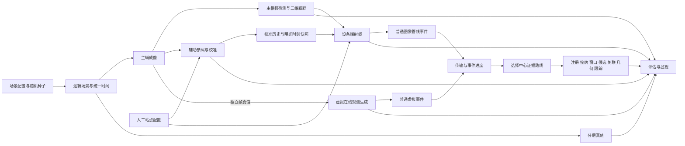

# 第二阶段代码框架索引

本阶段把模块的输入、输出、状态所有权和装配关系写成 Python 类型、Protocol 与架构桩。构造函数只绑定依赖；业务方法和生命周期方法保留 `NotImplementedError`。框架可以导入和审查，尚不能执行场景、生成图像、估计校准、定位目标或计算指标。

第三阶段沿这些端口实现模块。需求以 [`instruction.md`](../instruction.md) 为准，本文解释代码中的连接方式，不替代需求或确定实验阈值。

## 1. 目录与职责

| 位置 | 职责 | 下一阶段主要填空 |
| --- | --- | --- |
| [`contracts/model.py`](../src/chongming/contracts/model.py) | 在线公共标识、时钟、帧、站点配置、校准解/状态、射线及中心结果 | 实现配置读取、引用解析和边界校验；保持坐标、单位和会话作用域 |
| [`contracts/scene.py`](../src/chongming/contracts/scene.py) | 实验配置、真实生成参数、轨迹、可见性、主辅成像、分层真值、评估及监视快照 | 用场景配置和随机种子产生可重复的真实状态与输入 |
| [`contracts/device.py`](../src/chongming/contracts/device.py) | 二维候选/轨迹、参照观测、校准提案、设备端策略及逐帧结果 | 填入检测、跟踪、参照识别、校准与射线误差模型 |
| [`contracts/fusion.py`](../src/chongming/contracts/fusion.py) | 注册、接纳、事件进度、窗口、候选、关联、几何和中心跟踪记录 | 保留每一阶段的输入引用、失败原因和输出证据 |
| [`contracts/runtime.py`](../src/chongming/contracts/runtime.py) | 运行配置、模块启动组、证据路由、传输与运行报告 | 实现完整运行的启动、调度、结束及失败清理 |
| [`ports/scene.py`](../src/chongming/ports/scene.py)、[`device.py`](../src/chongming/ports/device.py)、[`fusion.py`](../src/chongming/ports/fusion.py) | 三条开发线及其细分模块的 Protocol | 按签名替换架构桩，保持输入输出和数据所有权 |
| [`ports/lifecycle.py`](../src/chongming/ports/lifecycle.py)、[`runtime.py`](../src/chongming/ports/runtime.py) | 统一模块生命周期和完整系统编排端口 | 实现就绪屏障、传输边界、证据保存和资源回收 |
| [`modules/`](../src/chongming/modules/) | 与端口相对应的空方法和构造注入 | 在明确的模块内填业务实现；[`base.py`](../src/chongming/modules/base.py) 提供受管模块的共同生命周期边界 |
| [`composition/graph.py`](../src/chongming/composition/graph.py) | `declare_assembly` 创建场景、每站设备、中心、传输、评估、监视和证据组件的完整依赖图 | 对已验证配置进行装配；构造本身不启动模块 |
| [`scenarios/entrypoint.py`](../src/chongming/scenarios/entrypoint.py) | `declare_run` 声明从虚拟场景开始的完整运行入口 | 驱动场景和编排器；在正常结束及失败路径完成清理 |

`contracts` 保存数据声明，`ports` 保存可替换的行为边界，`modules` 保存依赖注入及待实现方法，`composition` 保存实际连接关系。`contracts/model.py` 不依赖场景真值，设备端和中心端端口也不导入场景契约。

## 2. 主数据流与模块输入输出



图中虚拟观测与成像共享逻辑产生的真实状态、投影和可见性记录；虚拟观测不等待主检测或辅助校准产生答案。主辅视频采用独立采样计划，`StationFrameSet` 中未采样的相机角色为 `None`。

| 模块/端口 | 输入 | 输出及所有权 |
| --- | --- | --- |
| `ExperimentClock`、`TrajectorySampler`、`SceneLogic` | `TimelineSpec`、`SceneDefinition`、扰动配置、随机种子、`SimulationTime` | `LogicalSceneSnapshot`；逻辑侧拥有相机实际状态、物体运动、投影和有限线段遮挡判断 |
| `CameraImager` | `ImageGenerationRequest`，包含逻辑侧给出的曝光采样状态 | `ImagingBatch`：在线 `CameraFrame` 与独立 `CameraFrameTruth`；成像器不推进时间，不重新定义捕捉条件 |
| `VirtualObservationGenerator` | 帧真值、在线站点配置、虚拟观测参数及本次运行的会话绑定 | 普通校准解/状态事件、射线、诊断；正确对应关系放在独立真值输出中 |
| `MotionDetector`、`Tracker2D`、`MainDetector` | 主相机帧及配置的检测/跟踪策略 | 二维候选、`Observation2D`、`MainDetectionResult`；站内 ID 不携带真值身份 |
| `ReferenceRecognizer`、`CalibrationEstimator`、`CalibrationStateManager` | 辅助相机帧、人工 `StationConfig`、参照配置及处理时间 | 参照观测、未接受的 `CalibrationAttempt`、可信 `CalibrationSolution` 和 `CalibrationStateEvent` |
| `CalibrationHistory`、`RayBuilder`、`DevicePipeline` | 主帧曝光时刻的校准历史快照、二维观测及站点配置 | `RayEvent` 或 `DiagnosticEvent`；`DeviceFrameResult` 保留检测/二维轨迹和完成进度 |
| `StationRegistry`、`CalibrationRegistry`、`EventAdmission` | 在线配置、校准解/状态及 `ReceivedEvent` | 不可变注册快照、接纳/隔离/拒绝记录；缺失引用不得用默认姿态替代 |
| `EventWindows` | 被接纳的射线、站点已完成事件时间进度、处理时钟映射 | `SealedObservationWindow`、水位线、迟到及封存记录 |
| `CandidateGenerator`、`CrossStationAssociator`、`GeometryRefiner` | 已封存窗口、候选和中心预测 | 独立站点计票候选、跨站观测分配、连续几何解及退化原因；候选位置不是最终测量 |
| `CenterTracker`、`FusionEngine` | 连续几何测量、已消费窗口进度及普通事件 | 中心会话内的 `TrackEvent`、含各阶段记录的 `FusionBatchResult` |
| `EventTransport` | `EventSubmission`、`ProgressSubmission` 及注入的通信实验设置 | 带到达时间的普通事件、完成进度、溢出/丢失等传输证据；中心不接收扰动标签 |
| `Evaluator`、`MonitorRenderer`、`EvidenceWriter` | 分层真值、在线记录、只读监视快照、完整运行 manifest | 分层指标、监视图像、运行证据；未支持的指标明确为未知，不填假零值 |

模块的具体输入输出以对应 Protocol 签名为准。例如，`GeometryRefiner.refine` 使用原始世界射线做联合连续定位，不能把体素中心或两两射线的中点当作最终答案；`CenterTracker.update` 消费已封存窗口，`predict` 读取预测而不推进滤波状态。

## 3. 一次完整运行如何启动

`declare_assembly(spec, run)` 会装配所有组件，并把受管模块放入同一个 `StartupPlan.modules`。声明的依赖表达构造注入关系，不表达“先开启一条算法线、成功后再开启另一条”。

`SystemRunner` 是持有这些绑定的编排主持者，负责调用受管模块的 `start_module` / `stop_module`。它不作为自身启动组中的 `ModuleShell` 成员，避免启动主持者递归启动自己。

第三阶段的运行顺序为：

1. 验证场景和运行配置。检查站点集合、搜索配置、坐标基准、时钟映射、摘要、会话新鲜性及唯一性；`declare_assembly` 不是配置读取或校验器。
2. 构造完整装配，创建证据 manifest。
3. 初始化同一启动组中的全部模块，在注册组件可用后登记人工在线站点配置，等待一个统一就绪屏障。任何初始化失败都终止该次运行，清理已经初始化的资源。
4. 全部模块就绪后，从场景源驱动统一时间并派发帧和事件。检测结果、可信校准解和首个射线属于数据是否可用，均不是模块能否启动的条件。
5. 正常结束或失败时执行结束流程，保存运行结果并关闭所有已初始化模块。

`RunSpec.center_input` 的两个枚举值为 `EventPath.IMAGE_PIPELINE` 和 `EventPath.VIRTUAL_RAYS`。两种选择都启动并运行主检测、辅助校准、设备端射线和虚拟观测生成；区别仅是中心消费哪一路事件及其匹配的校准记录和事件时间进度。非选中路线仍留下供评估审查的记录。

每个站点的 `StationSessionBinding` 分别提供 `image_session_id` 和 `virtual_session_id`。主辅图像、设备端本地轨迹及图像管线事件使用图像会话；虚拟射线、虚拟校准及诊断使用虚拟会话，各有自己的 `EventSequencer`。同一路会话的射线、校准和诊断共享一个唯一序号空间，两条路线之间不共享会话和序号。相同随机种子也不能复用上一运行的站点或中心会话 ID。

## 4. 真值、时间与误差的边界

真实生成参数在 `SceneDefinition` / `SceneCameraSpec` 中，在线估计参数在 `StationConfig` 中。相机实际内参、实际光心和实际轨迹不能从带误差的在线估计配置反向生成，否则同一份错误会在成像和反投影中抵消。公共 `GeodeticAnchor` 明确基准、基准历元和高程语义；这些元数据需要在运行前与站点配置核对。

生成侧与编排器可以持有完整场景。在线派发只取 `OnlineScenarioStep` 中的帧和普通事件。`ScenarioTruth`、真实目标 ID、正确跨站对应关系、实际姿态和扰动参数仅用于生成、评估、监视及独立证据保存，不送到设备端或中心求解端口。通信扰动在传输边界施加，中心看到的是正常事件、到达时间和进度。

评估对应关系同时保留源图像会话和虚拟射线的复合 `EventId`，解决两条路线之间的引用问题；这张对应表不能随在线事件传送。帧引用使用 `FrameRef` 的站点、会话、相机角色和帧 ID，校准引用也包含站点及会话，避免重启或不同站点同号 ID 的混用。

权威观测时刻是 `CaptureTime` 的曝光中点。`ProcessingTime` 记录处理或到达时刻，只有经过 manifest 声明的时钟映射才能与曝光时刻比较。`ClockDomainSpec` 明确实验时间的起点和时间尺度；未经建模的滚动快门不能默认为已知全局快门。

主帧射线使用 `CalibrationHistory.snapshot_at` 选择曝光时刻已经知道的校准解及健康状态。较晚的辅助结果不得倒灌到较早的主帧，后来到达的健康事件也不能覆盖历史射线自身的使用状态。可信校准解保持不可变；健康状态变化可以继续引用原解。

捕捉条件由逻辑层负责：目标中心参考点在视场内，并且从相机光学中心到该点的有限线段未受世界物体阻挡。目标后方的障碍物不能造成遮挡。成像器消费这一判断，监视器只渲染提供的 `MonitoringSnapshot`；刷新频率不能推进仿真时间或改变曝光、采样和丢帧规则。

独立像素/射线误差与共享安装、外参、校准误差分开表达。首版三维测量和轨迹的 `conditional_*` 协方差条件于已经登记的安装配置和校准解；共享误差通过独立实验扫描另报绝对精度。重复引用同一校准解的多帧不能被当成共享误差相互独立的观测，进而宣称绝对协方差无限收缩。

## 5. 边界场景的纸面行为

以下约束已由类型、端口说明和装配声明表达；本阶段不执行这些行为。

| 情况 | 后续实现应采取的行为 | 应保留的记录 |
| --- | --- | --- |
| 模块已启动，但从未获得可信校准解 | 主检测照常处理；没有可用解的观测仅产生诊断，不把安装基准伪装成新鲜校准，不构造零向量射线 | 检测结果、校准健康状态、诊断及完成进度 |
| 参照识别失败，已有可信解 | 保留最后可信解和原 ID；按校准策略进入 `frozen` / `stale`。射线明确携带使用状态，中心依注入策略接纳、降权或拒绝 | 最后可信时间、历史解、健康变化和射线使用证据 |
| 主帧成功处理但未检测到候选 | `PROCESSED` 加空观测，发送完成进度，不制造射线；不能等同处理失败或丢帧 | 空检测批次、二维轨迹生命周期和事件进度 |
| 某步主相机或辅助相机未采样 | 未采样角色为 `None`；继续设备健康和中心时钟检查，不等待辅助帧，不伪造曝光记录 | 实际已有帧、健康变化及窗口/跟踪进度 |
| 射线先于配置或校准解到达 | 隔离并保留原到达证据；注册补齐后可重新审查，但不能绕过时间窗口限制 | 接纳日志、缺失引用及重审结果 |
| 重复 `EventId` 或同 ID 不同内容 | 重复和冲突分别记录；不重复更新窗口或轨迹，不覆盖第一次接收的原始载荷 | 注册/接纳日志和原因码 |
| 射线在窗口封存后到达 | 首版严格封存：记录迟到，只送评估及审计，不重新打开窗口，不回写已经发布的测量或轨迹 | 迟到事件、原窗口和封存原因 |
| 设备或中心重启 | 使用新会话；旧校准 ID 不能解析成新会话的同号解；设备重新取得并登记可信解之前只保留合法诊断路径 | 新旧会话边界、注册结果和初始化状态 |
| 搜索范围内无候选、关联歧义或几何退化 | 输出明确状态及支持引用；允许没有位置和协方差。搜索盒中无候选不证明整个世界没有目标 | 候选检查范围、冲突、几何条件和失败原因 |
| 暂时没有事件 | 根据进度、超时和站点状态推进窗口；中心跟踪的有效时间不得越过尚未消费的开放窗口 | 空窗口、站点状态、封存记录及跟踪生命周期 |
| 场景正常结束，包括零帧场景 | 停止源并提交两路结束进度；传输排空或明确丢弃此前提交的事件后，释放保留的结束进度。仅选中路线进入中心，再封存、完成评估和清理。零帧结束使用 `stream_ended=True`、`completed_capture_time=None` | 结束标志、排空报告、最终窗口、评估报告及关闭报告 |
| 初始化失败或运行失败 | 记录失败并关闭全部已初始化资源，不以关闭某条分支继续冒充完整运行 | 模块健康、失败原因、已取得的证据及关闭结果 |

传输进度不能越过它所描述的事件交付。通信延迟、丢失、重复和有限存储策略在 `EventTransport` 边界处理，溢出必须有证据，不能静默丢弃后再用提前的进度制造“已经处理完整”的假象。

结束时调用 [`EventTransport.drain(path, now, deadline)`](../src/chongming/ports/runtime.py)，截止时刻由 `TransportPolicy.drain_timeout_ns` 定义，使用处理时钟。`TransportDrainResult` 保存末尾投递、截止丢弃、剩余事件/进度数量及失败原因；一次空 `collect` 不等于已经排空。`EvidenceWriter.record_transport` 和 `record_drain` 保存两条路线的投递、丢弃及失败时的 pending 状态，排空失败也必须继续清理资源。

全部已注册流结束后，[`EventWindows.report_progress`](../src/chongming/ports/fusion.py) 用 `STREAMS_ENDED` 封存到最后完成曝光或缓冲射线所在窗口；这一有限结束规则覆盖 `HOLD`。零帧且无射线的运行不造窗口，传输排空截止时间不能扩展实验时间。日常推进中也保留符合封存条件的空窗口，供跟踪按实际已消费的窗口进度处理无观测状态。

## 6. 第三阶段填空顺序

1. **共同基础与虚拟环境。** 实现配置验证、统一时间、轨迹、坐标投影、有限线段可见性和主辅基础成像；补分层真值、最小监视及证据保存。同时实现完整启动屏障、结束和失败清理，保证每次验证均从场景启动完整组件集合。
2. **三条算法线并行。** 主相机线填 `MotionDetector` / `Tracker2D`；辅助线填参照识别、校准估计、健康状态和历史；中心线以虚拟在线事件填注册、接纳、窗口、候选、关联、连续几何和三维跟踪。三条线共同启动，可信结果是否出现不影响其他线运行。
3. **接通图像证据路线。** 实现曝光兼容的校准快照、设备端世界射线及独立/共享误差传播；中心继续只接收普通世界射线，评估与虚拟路线共用相同契约。
4. **集成回归与实验。** 验证空检测、冻结/恢复、不同步、重复、迟到、重启、退化和结束行为，再增加植被、风、云层和通信扰动。按目标像素尺寸、距离、速度、背景、光照、遮挡等分层报告误差与性能。

步骤描述开发次序。系统验证使用完整启动组；真实业务输入不足时遵循空结果和诊断契约，不能通过路线选择从装配中删除模块，也不能用假结果掩盖未实现方法。

## 7. 当前取舍和延后决定

当前装配用同一进程中的 Python 对象表达依赖，数据采用不可变 dataclass，行为采用 Protocol。构造时不启动线程、进程、网络或窗口；这种声明方式方便检查所有权和依赖，也允许第三阶段先用简单调用关系实现。具体并发、进程和通信模型仍待测量，不由目录或 Protocol 提前决定。

OpenCV 是首个视觉/几何算法后端，后端通过已有端口替换。之后若需要 C/Rust 性能实现，保留同一数据契约和端口，不把后端库对象传入逻辑场景、在线事件或跨模块配置。

严格封存使结果只能向前发布，便于解释在线延迟和跟踪状态；代价是迟到观测只能用于该次运行的评估及审计，不能改善已经发布的历史估计。精确封存时间由配置策略决定，本阶段不指定迟到容忍量或超时数字。

以下选择继续保留为配置或后续讨论：检测/校准/关联/几何门限、分数跨站可比性、恢复成功条件、体素范围与步长、粗候选与直接几何策略、鲁棒损失与运动对齐模型、滚动快门及共享误差的扩展建模、最终序列化、并发/进程模型、具体硬件和性能优化。条件协方差不代表已经联合建模共享误差，也不构成绝对精度承诺。

`EvidenceWriter` 保存场景、随机种子、版本、配置、日志、真值和指标，支持重新生成实验。框架没有录制数据作为算法输入的回放端口，不以录制/回放替代虚拟场景基础设施。

## 8. 检查命令

在仓库根目录执行：

```sh
uv run ruff check .
uv run ruff format --check src tests
uv run mypy src tests
uv run python -m unittest discover -s tests -v
```

这些检查验证格式、类型、装配及架构契约。通过检查不代表检测、校准、定位或场景算法已经实现；业务方法当前仍应明确抛出 `NotImplementedError`，不得为了使框架“看起来能跑”返回假图像、假射线或假指标。
