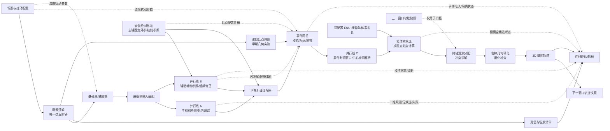
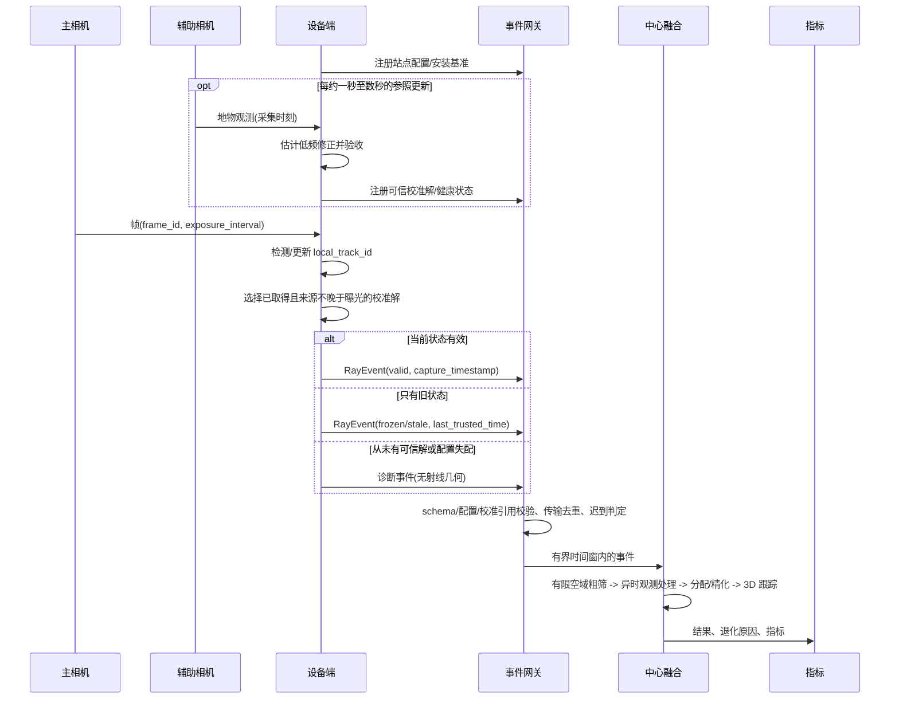
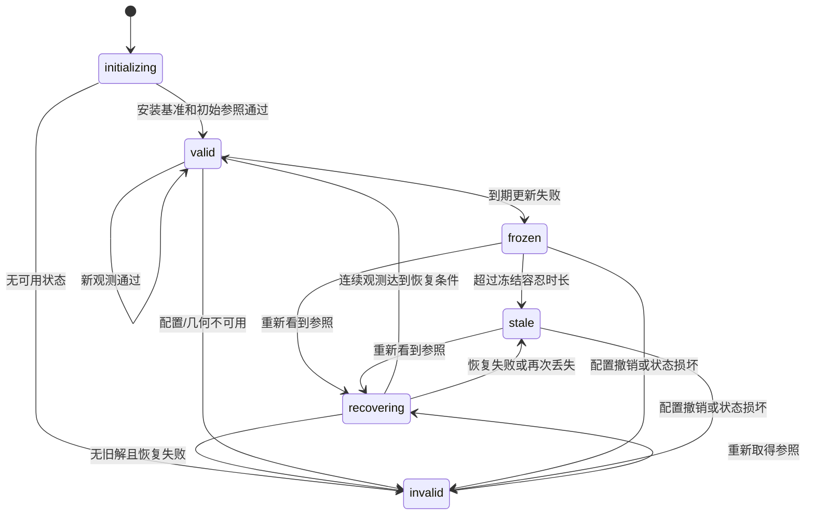

# 架构图提案

状态：提案，2026-10-12。图中的模块和接口用于第二阶段架构桩；它们表达契约和依赖，不代表已经实现或可运行。

## 组件图

约束：先完成 `SC + RI + VS + GT` 的场景基础版，随后 A/B/C 三线并行，世界射线集成在后。`SC` 拥有仿真时间；`RI`、`DET`、`CAL` 和中心端都不能推进它。`BASE` 是安装配置而非仿真真值；`CAL` 不在线重估主辅固定外参，也不主动补偿高频抖动。`EG` 持有已注册配置/校准解的查询入口，缺失引用的射线不能进入融合。`SPACE` 是预设搜索范围而非目标真值，范围外不保证生成体素候选。`PRIOR` 与 `NEXT` 属于不同时间窗口，由中心调度者持有快照，组件不反向依赖轨迹模块。`VS` 与图像路径产出同一在线事件契约，亦须注册在线侧可见的配置与校准解；不得输出真值目标 ID、正确跨站对应关系，或将仿真真值配置冒充为有误差的设备估计配置。诊断旁路只进 `EV`；`GT` 和 `EV` 不向在线模块供给答案。姿态漂移在场景真实状态中注入，参照遮挡/成像噪声在图像边界注入，通信扰动在事件边界注入；不直接篡改校准或中心求解结果，也不依赖回放文件。

## 事件时序图

事件时间使用采集/曝光时间；网关到达时间只用于延迟、乱序和资源指标。超过有界迟到窗口的事件仍记录为错误或诊断信息，但不修改已经封存的融合结果。

## 校准状态机

`frozen` 和 `stale` 不产生新的有效状态版本；恢复中未通过门槛时沿用旧解的 `frozen/stale` 标记，没有旧解则只发诊断事件。恢复条件、冻结容忍时长和不确定度增长模型属于实验配置，必须写入运行 manifest。

## 图的使用方式

1. 第一阶段用本文图确定组件、时序、状态和接口所有权；标定硬件与地物参照路线留待虚拟场景完成后。
2. 第二阶段把接口、类型、空方法和装配关系写成架构桩，不要求运行。
3. 第三阶段从 `SC` 启动完整链路；早期可用虚拟站点观测，后续替换为完整图像链路。
4. 同步、丢包、重复、退化几何和校准失败由当次场景配置注入，并由 `EV` 在线统计。
